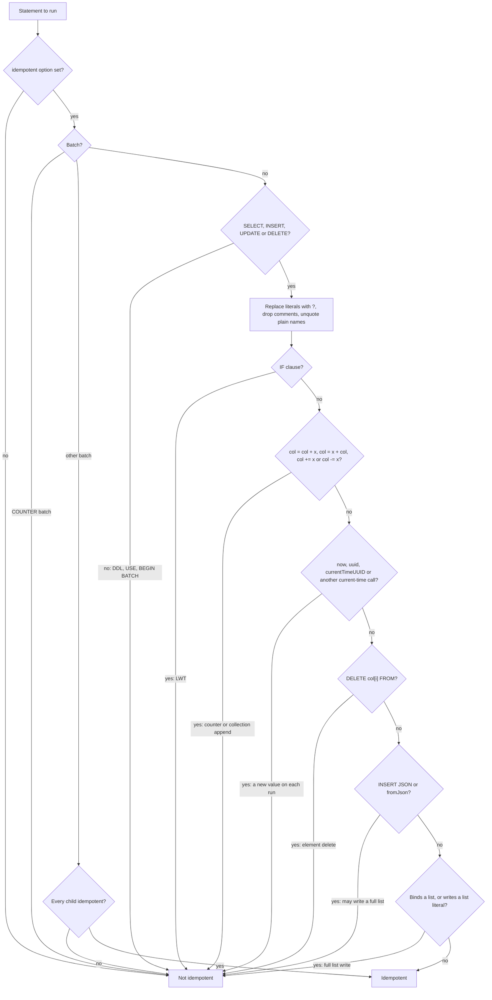

# QATOOLS-413 — Idempotent statements and speculative execution

## Overview

Two new `-mode` options let a user opt in. `idempotent` marks each safe
statement as idempotent. `speculativeExecutions=` and `speculativeDelay=`
configure a constant speculative execution policy in the driver. The shared
client classifies every statement from its CQL text before it runs. A
statement that can change state on replay stays non-idempotent, so the driver
never replays it. Both driver clients (3.x and 4.x) apply the same classifier
and the same policy. Without the new options, behavior is the same as today.
The integration tests run on ScyllaDB 2026.3, and the example profiles create
`NetworkTopologyStrategy` keyspaces.

## Constraints

- The classifier errs to non-idempotent. A false "not idempotent" only loses
  the speed-up. A false "idempotent" corrupts data on replay.
- List appends and prepends are not idempotent. `ProfileInsert` writes
  `col = col + ?` for every non-frozen list or set column in a user profile.
- The 3.x and 4.x drivers count speculative executions differently. The CLI
  value has one meaning, and each client converts it.
- The 4.x driver ships only the constant speculative execution policy.
- An unprepared statement carries its values inline, as blobs of any size.
  The classifier runs in linear time on that text.
- ScyllaDB 2026.3 refuses a `SimpleStrategy` keyspace when tablets are on.
- Both drivers start a speculative execution on a timer wheel that ticks
  every 100 ms by default. A 100 ms delay then costs 200 ms or more.
- A full write of a non-frozen list is not idempotent. Each coordinator makes
  the element keys from its own timeuuid node, so a replay with the same
  timestamp doubles the list. The bind variable metadata of the protocol does
  not mark a list as frozen, so every list bind variable counts.
- A JSON write can carry a full list in its value. The text and the bind
  variable types do not show the columns that the JSON sets.
- CQL names `c` and `"c"` as the same column. A user profile can spell one
  column both ways in one statement.

## Design

`SettingsMode` parses and validates the new options. `AbstractStressClient`
asks `StatementIdempotence` about each statement and passes the answer to
the driver-specific statement builder. Each client adds the speculative
execution policy to its cluster or session configuration.



The classifier reads the query text the driver gets. For a prepared statement
that is the prepared query. For an unprepared statement it is the query with
the values filled in. One pass first replaces each string, `$$` string and
blob literal with `?` and drops each comment. The same pass removes the
quotes from a quoted name that is a plain identifier. The rules then read the
shape of the query and never its values. They compare names without case, so
`"C0"` and `c0` count as one column.

Schema statements (`execute(String, ConsistencyLevel)`) are never idempotent.

| Condition | Behavior |
|---|---|
| `speculativeExecutions=` or `speculativeDelay=` set without `idempotent` | Reject the settings with an error that names `idempotent` |
| Only one of `speculativeExecutions=` and `speculativeDelay=` set | Reject the settings with an error that names the missing option |
| `speculativeExecutions=` below 2 | Reject the settings: one execution is no speculation |
| A speculation value above the integer range | Reject the settings with an error that names the option |
| `speculativeDelay=0` | Reject the settings: every execution would start at once |
| `idempotent` set on `counter_write` | Run. Every counter statement is non-idempotent. |
| A speculative execution fails | The driver behavior applies: the first response wins |

## Contracts

### Inputs

```
-mode cql3 native|4x [idempotent] [speculativeExecutions=<N>] [speculativeDelay=<ms>]
```

- `idempotent`: a flag, like `unprepared`. Marks safe statements idempotent.
- `speculativeExecutions=<N>`: the total number of executions per request,
  the first one included. `N >= 2`.
- `speculativeDelay=<ms>`: the delay before each new execution.

Driver mapping of `N`:

| Driver | Setting |
|---|---|
| 3.x | `new ConstantSpeculativeExecutionPolicy(delay, N - 1)`, and a `HashedWheelTimer` with a tick of `min(10 ms, delay)` through `NettyOptions.timer()` |
| 4.x | `advanced.speculative-execution-policy.class = ConstantSpeculativeExecutionPolicy`, `max-executions = N`, `delay = <ms>`, `advanced.netty.timer.tick-duration = min(10 ms, delay)` |

### Outputs

The `-mode` section of the startup settings adds two lines:

```
  Idempotent Statements: true
  Speculative Execution: 3 executions, 500 ms delay
```

Without the options:

```
  Idempotent Statements: false
  Speculative Execution: none
```

### Module API

```java
// org.apache.cassandra.stress.settings.SettingsMode
public final boolean idempotent;
public final Integer speculativeExecutions; // null when off
public final Integer speculativeDelay;      // milliseconds, null when off

// org.apache.cassandra.stress.driver.StatementIdempotence
public static boolean isIdempotent(String cql);

// org.apache.cassandra.stress.driver.StressPreparedStatement
boolean isIdempotent(); // the classifier result for the prepared query
```

## Risks

| Risk | Response |
|---|---|
| A query shape the classifier does not know replays with a side effect | The classifier accepts only plain DML. Each rule has a unit test case. |
| Speculation adds load to a cluster that is already overloaded | Opt-in only. The delay sets how soon extra requests go out. |
| A single node test cannot show a slow coordinator | `SpeculativeExecutionIT` starts three nodes at RF=3 and pauses one coordinator during the run. Without speculation the run fails with a client timeout. With speculation it has no error and stays under half the timeout. |
| A frozen replica slows writes on the server | The coordinators throttle background writes to the frozen replica. Speculation does not remove this cost. |

## Deferred work

- A percentile-based speculative execution policy. It exists only in the
  3.x driver. The option names leave room for a `speculativePolicy=` option.

## Decisions

- Idempotence is set per statement, not as the driver default. Both drivers
  then follow one classifier, and DDL stays non-idempotent. (spec)
- The classifier reads the CQL text, and for a prepared statement also the
  bind variable types. The text covers unprepared statements and Cassandra,
  which has no LWT metadata flag. The types find a list that the text
  binds as `?`. (review)
- Speculative options require `idempotent`. The driver ignores speculation
  for a non-idempotent statement, so the options alone would do nothing. (spec)
- `speculativeExecutions=` counts the first execution, as the 4.x driver
  does. (spec)
- `speculativeDelay=` has no default value. It is required with
  `speculativeExecutions=` and must be 1 or more. (review)
- The integration tests run on ScyllaDB 2026.3, where tablets support every
  table type. The counter test then needs no keyspace without tablets. (build)
- The example profiles and the README use `NetworkTopologyStrategy`.
  ScyllaDB 2026.3 refuses `SimpleStrategy` with tablets. (build)
- With speculation on, the driver timer ticks every `min(10 ms, delay)`. The
  delay is then accurate to one tick. (build)
- The classifier replaces literals before it applies the rules. A rule then
  costs linear time on an unprepared statement with large blobs. (review)
- Every JSON write is non-idempotent. The classifier cannot see which columns
  the JSON sets, and a full list write doubles the list on replay. (review)
- Names compare without case after the quotes come off. `"C0"` and `c0` then
  count as one column. That errs to non-idempotent. (review)
