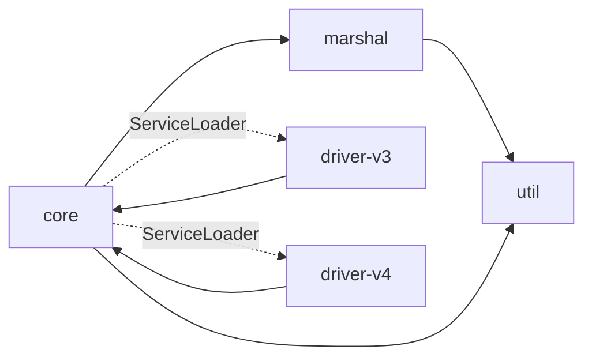
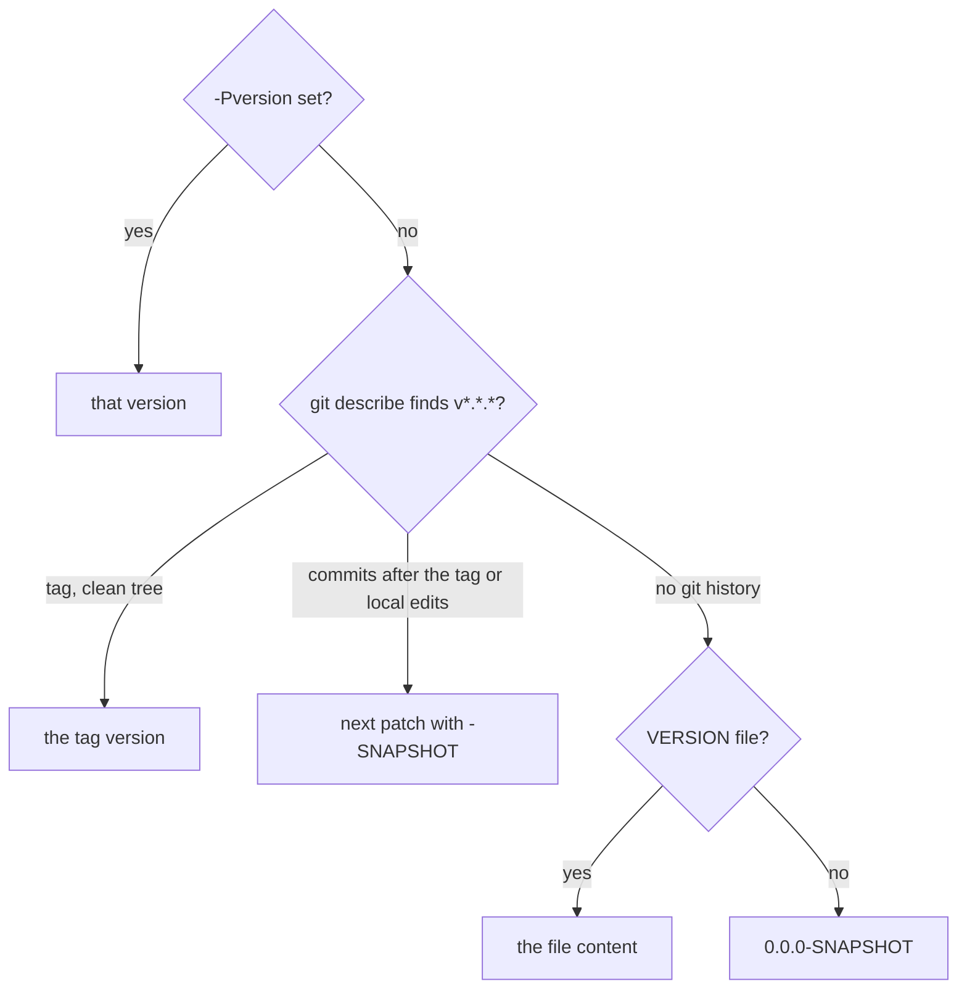
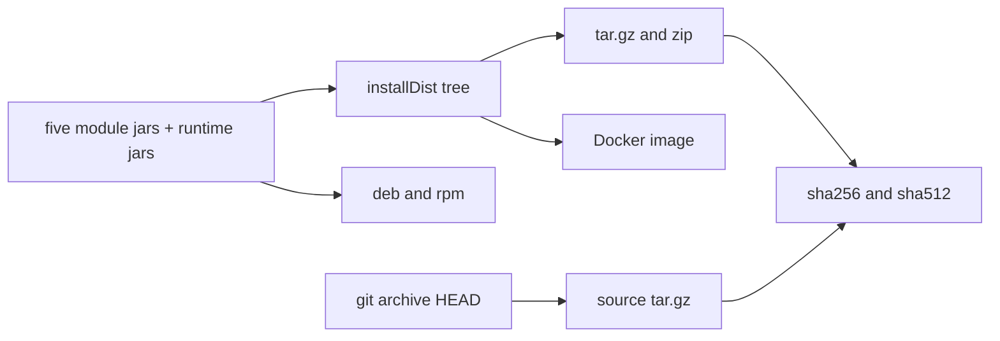

# QATOOLS-579 — Move the build from Ant XML to task-oriented Gradle builds

## Overview

Gradle 9 with the Kotlin DSL replaces Ant. The code splits into five Gradle
subprojects under `src/`, and each subproject is a Java module. Convention
plugins in `build-logic` hold the compile, test and lint setup that every
module shares. The root project builds the archives, the deb, the rpm and the
Docker image from one `installDist` tree. The launcher runs stress on the
module path. The launcher and package tests are JUnit tests that Gradle runs
against Testcontainers. The version comes from the latest release tag.

## Constraints

- The code compiles with `--release 21` and runs on JDK 21 and on every
  later LTS release. CI runs JDK 21 and 25.
- The release artifacts keep their names, so the release workflow and its
  users see no change.
- No `--add-opens` and no `--add-exports` in the launcher. A module cannot
  open a JDK package.
- The deb and the rpm keep the user edits of `/etc/cassandra-stress` across
  an upgrade from the Ant-built packages.
- Every external action, plugin, library, base image and the Gradle
  distribution have a pinned version.

## Design

### Projects and modules

| Gradle project | Directory | Java module |
|---|---|---|
| `:util` | `src/util` | `org.apache.cassandra.stress.util` |
| `:marshal` | `src/marshal` | `org.apache.cassandra.stress.marshal` |
| `:core` | `src/core` | `org.apache.cassandra.stress` |
| `:driver-v3` | `src/driver-v3` | `org.apache.cassandra.stress.driver.v3` |
| `:driver-v4` | `src/driver-v4` | `org.apache.cassandra.stress.driver.v4` |



`core` finds a driver only through the `StressClientProvider` service. A
driver module provides the service with `provides` in `module-info.java` and
with a `META-INF/services` file, so the service also works on the classpath
of the tests.

A dependency jar without a module name gets an `Automatic-Module-Name` from
an artifact transform at resolution. The same transform removes the
`BlockHoundIntegration` service file of the shaded Scylla driver 3.x jar,
because it names a class that the jar does not hold.

### Build logic

| Component | Role |
|---|---|
| `gradle/libs.versions.toml` | Every library and plugin version |
| `cassandra-stress.java-module` | Compile with `--release 21`, the module version, JUnit, JaCoCo, Spotless, Error Prone, Checkstyle, PMD, SpotBugs |
| `cassandra-stress.packaging` | The `distribution` and the nebula `ospackage` plugins |
| `cassandra-stress.kotlin-format` | ktlint for the Gradle build scripts and the build logic |
| Root `build.gradle.kts` | The distribution, the archives, the checksums, the deb, the rpm, the Docker image, the coverage report |
| `settings.gradle.kts` | The projects, the driver version overrides, the version |

Error Prone runs as its own javac process for each source set. A finding
fails the `lint` task. The compile tasks keep the plain javac output on every
JDK. Checkstyle, PMD and SpotBugs also check every source set.
`modulePathCheck` fails when a jar of the distribution has no module name.

### Version



The source archive carries the `VERSION` file, so a build from it prints the
version of the release.

### Artifacts



The deb and the rpm install into `/usr/share/cassandra-stress`, keep `conf`
in `/etc/cassandra-stress` as configuration files, and link
`/usr/bin/cassandra-stress`. The Docker image is one runtime stage that
copies the `installDist` tree.

### Tests

| Task | What runs | Where |
|---|---|---|
| `test` | The unit tests of each module | Classpath |
| `:core:integrationTest`, `:core:integrationTest4x` | Stress in-process against ScyllaDB, one target of the `integrationTest` suite per driver | Testcontainers |
| `:core:distributionTest` | `bin/cassandra-stress` of the `installDist` tree with both drivers | Testcontainers |
| `:core:packageTest` | The deb or the rpm with a Temurin runtime in a clean image, then `cassandra-stress version` | Testcontainers |
| `jacocoFullReport` | One coverage report for the unit and the integration tests | — |

The tests read `examples/` and `conf/`, and these directories are inputs of
every test task. `packageTest` is never taken from the build cache, because it
installs a Java runtime from the network.

`-PintegrationDriver=native` or `-PintegrationDriver=4x` runs the integration
tests with one driver, and any other value fails the build. The
`testcontainers.yml` workflow runs `jacocoFullReport` on JDK 21 in one job for
each driver. It runs on a pull request with the `testcontainers` label and on
each push to `master`.

The ScyllaDB test node listens on its shard-aware port with the same number
on the host and in the container, because driver 3.x connects to the port
that the node advertises.

### JVM options

The root build writes two JVM options files into `conf/` of every
distribution. The `jvmClientOptions` task writes `jvm-clients.options`, and
the `jvmGcOptions` task writes `jvm-gc.options`. A line
`<min>-<max>:<option>` or `<min>-:<option>` applies to those Java versions
only, and the launcher skips the other lines. A bound is a dotted version, and
a short bound covers its updates, so `21.0.9-21` holds 21.0.9 and every later
update of 21. The launcher reads the version from the `release` file of the
JDK.

| Option | Java | Why |
|---|---|---|
| `-XX:+UseZGC` | 21.0.9 to 21, 24.0.2 and later | Pauses below one millisecond, so the latency that stress reports is the latency of the cluster |
| `-XX:+UseG1GC` | 21 to 21.0.8, 22 to 24.0.1 | Generational ZGC can crash when it collects the old generation ([JDK-8347564](https://bugs.openjdk.org/browse/JDK-8347564)). These releases do not have the fix |
| `-XX:+ZGenerational` | 21 and 22 | Without it, Java 21 and 22 start the single-generation ZGC. Java 24 and later warn on it, and G1 ignores it |
| `-XX:MaxRAMPercentage=80`, `-XX:MinRAMPercentage=80` | 21 and later | The heap can grow to 80% of the memory of the machine or the container. `MinRAMPercentage` sets the maximum heap on a machine with little memory |
| `-XX:MaxDirectMemorySize=256m` | 21 and later | The direct buffers have their own limit. By default, the limit is the maximum heap, so the heap and the direct buffers could take 160% of the memory. With `noUnsafe`, netty prefers heap buffers, and the workloads of `distributionTest` pass with a limit of 16 MB |
| `-XX:+AlwaysPreTouch` | 21 and later | The first requests take no page faults on the initial heap |
| `-XX:+PerfDisableSharedMem` | 21 and later | A slow write to the `hsperfdata` file in `/tmp` cannot stall a safepoint |
| `-XX:+UseCompactObjectHeaders` | 25 and later | Object headers of 8 bytes, so each request uses less heap. Java 24 has them as an experimental option only |

The launcher sets no initial heap size, so `-XX:+AlwaysPreTouch` touches a
small heap and each run starts fast. The launcher puts `JVM_OPTS` after the
default options, so an option in `JVM_OPTS` wins. The JVM stops when two
options select a collector. A collector in `JVM_OPTS`, `JAVA_TOOL_OPTIONS` or
`JDK_JAVA_OPTIONS` makes the launcher skip the lines of `jvm-gc.options` that
select a collector. The other lines still apply, so `JVM_OPTS=-XX:+UseZGC` on
Java 21 starts generational ZGC.

### Failure behavior

| Condition | Behavior |
|---|---|
| Java older than 21 | The launcher stops before the JVM starts and names the Java version |
| `conf` has no JVM options file | The launcher reads the `conf` directory next to `lib`, and warns when that directory has no file either |
| The storage directory is not writable | The launcher warns and keeps the logs in `$TMPDIR/cassandra-stress-<uid>` |
| No git checkout | `sourceTar` is skipped, every other artifact builds |
| The free shard-aware port is taken before Docker binds it | `ScyllaNode` starts the node again with a new port, up to three times |
| An Error Prone finding | `lint` fails and writes the report |

## Contracts

### Inputs

```
git describe --tags --match 'v[0-9]*.[0-9]*.[0-9]*' --dirty   # the version
git archive HEAD                                              # the source archive
```

```
-Pversion=<version>                 # the version of one build
-PscyllaDriver3Version=<version>    # another Scylla Java driver 3.x
-PscyllaDriver4Version=<version>    # another Scylla Java driver 4.x
-PtestJvmArgs=<args>                # extra JVM arguments of every test JVM and of the launcher in distributionTest
-PintegrationDriver=native|4x       # the one driver of the integration tests
-PdockerImage=<repository>          # default scylladb/cassandra-stress
-PdockerPlatforms=<platforms>       # for example linux/amd64,linux/arm64
-PdockerPush=true                   # push the image instead of loading it
-Dscylla.image=<image>              # the ScyllaDB image of the integration tests
-Dstress.package.images=<images>    # the images of packageTest
-Dstress.package.java=<versions>    # the Java versions of packageTest
```

### Outputs

`./gradlew assemble -Pversion=3.22.0` writes `build/distributions`:

```
cassandra-stress.tar.gz          cassandra-stress.tar.gz.sha256   cassandra-stress.tar.gz.sha512
cassandra-stress.zip             cassandra-stress.zip.sha256      cassandra-stress.zip.sha512
cassandra-stress-src.tar.gz      cassandra-stress-src.tar.gz.sha256  cassandra-stress-src.tar.gz.sha512
cassandra-stress_3.22.0_all.deb
cassandra-stress-3.22.0-1.noarch.rpm
```

Each checksum file holds the hex digest only. The build workflow renames the
files to the release names, such as `cassandra-stress-bin-java21.tar.gz` and
`cassandra-stress-java21_3.22.0_all.deb`.

The deb control fields:

```
Package: cassandra-stress
Architecture: all
Depends: temurin-21-jre | temurin-25-jre | openjdk-21-jre-headless | openjdk-25-jre-headless | java21-runtime-headless, awk
```

The rpm requirements:

```
Requires: (temurin-21-jre or temurin-25-jre or temurin-21-jdk or temurin-25-jdk or jre-21-headless or jre-25-headless)
Requires: bash coreutils findutils gawk grep
```

The launcher command:

```
java <conf/jvm-clients.options> <conf/jvm-gc.options> $JVM_OPTS --module-path lib --add-modules ALL-MODULE-PATH \
  -Dcassandra.storagedir=... -Dcassandra.logdir=... \
  -Dlogback.configurationFile=conf/logback.xml \
  -m org.apache.cassandra.stress/org.apache.cassandra.stress.Stress <args>
```

`./gradlew dockerImage` tags `<repository>:<version>` and `<repository>:latest`
with the label `org.opencontainers.image.version=<version>`.

### Module API

```java
public interface StressClientProvider {
    ConnectionAPI api();
    String name();
    String version();
    StressClient create(StressSettings settings, List<String> hosts, int port, EncryptionOptions encryptionOptions);
}
```

```java
module org.apache.cassandra.stress.driver.v3 {
    requires transitive com.scylladb.driver.core;
    requires transitive org.apache.cassandra.stress;
    provides org.apache.cassandra.stress.driver.StressClientProvider with
            org.apache.cassandra.stress.driver.v3.V3ClientProvider;
}
```

## Risks

| Risk | Response |
|---|---|
| The nebula ospackage plugin and its redline library are old and not configuration-cache safe | The package tasks opt out of the configuration cache, delete the old package before they write, and `packageTest` installs both packages in CI |
| Jars of two releases in one `lib/` stop the JVM on the module path | The README says to unpack a new release into an empty directory. The packages replace their files on upgrade |
| `--release 21` does not stop a later JDK from warning about `sun.misc.Signal` | Error Prone runs in its own javac process and fails on its findings only |
| The heap of each process can grow to 80% of the memory, so two stress processes on one loader can use more memory than the loader has. SCT starts one container for each stress command, without a memory limit | `-XX:+ZUncommit` stays on and returns unused memory after 300 seconds. A run that shares a loader sets `-Xmx` in `JVM_OPTS`, as the SCT performance tests do |
| The scylla-dtest container has a memory limit of 256 MB. A heap of 80% leaves about 50 MB for the class metadata, the thread stacks and the compiled code | The direct buffers have a limit of 256 MB. scylla-dtest sets `-Xmx` in `JVM_OPTS` or raises the limit before it moves to this image |
| A local `dockerImage` tags `latest` over an image pulled from Docker Hub | The README names the repository property |

## Deferred work

- A package repository for the deb and the rpm. The package names and the
  file layout stay stable for it.
- Gradle dependency verification, with the checksum of every downloaded
  artifact in `gradle/verification-metadata.xml`.

## Decisions

- Gradle with the Kotlin DSL replaces Ant, and Gradle runs every build and
  test step. (spec)
- Each Gradle subproject is also a Java module, on the same branch as the
  Gradle move. (spec)
- The code compiles with `--release 21` and runs on every LTS release from
  21. (spec)
- No `--add-opens` in the launcher. The opens that the classpath build
  carried are not needed on the module path. (build)
- The test node maps the shard-aware port, so driver 3.x runs unchanged
  against a container. (build)
- The subprojects live under `src/`, and the Gradle project paths stay the
  module names. (build)
- The Makefile goes, because Gradle holds every shortcut it held. (build)
- The version comes from the release tag, so no release edits a build
  file. (build)
- Gradle builds the Docker image from the `installDist` tree. (build)
- The launcher and package scripts become JUnit tests that Gradle runs. (build)
- The module transform stays in `build-logic`. The gradlex
  `extra-java-module-info` plugin cannot remove a service file from an
  automatic module. (build)
- Error Prone stays a separate javac process. With `--release`, javac warns
  on `sun.misc.Signal` in every case, so `-Werror` cannot gate Error Prone. (build)
- The integration tests run on JDK 21 only, in one job for each driver, behind
  the `testcontainers` label, so a pull request without the label does not
  wait for ScyllaDB. (build)
- ZGC is the default collector, and Gradle writes the JVM options into
  `conf/`. A Java release without the fix of JDK-8347564 runs on G1. (build)
- The maximum heap is 80% of the memory. The initial heap stays at the default
  of the JVM, so a run starts fast. (build)
